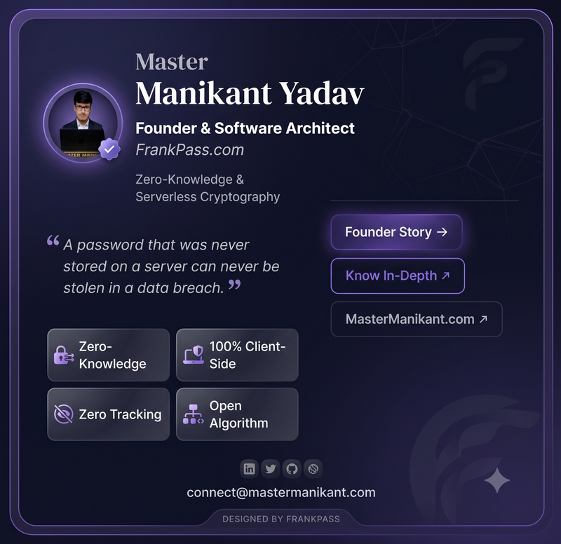

# Master Manikant Yadav (मास्टर मणिकान्त यादव)

> **Solopreneur Systems Architect & Educator**  
> Based in Supaul, Bihar, India | Official Sovereign Hub: [mastermanikant.com](https://mastermanikant.com)

   
  
   
  <em>Master Manikant Yadav with the FrankPass Sovereign Cryptographic 3D Lock</em>
    

---

### 🛡️ About Me

I am a solopreneur systems architect and mathematics educator dedicated to sovereign, zero-bloat digital infrastructure and deterministic, client-side cryptography.

- 📐 **Academic Foundations:** B.Sc Pure Mathematics (Honors) from B.N. Mandal University (BNMU), Bachelor of Education (B.Ed.) from Jiwaji University.
- 🎯 **Merit Recognition:** Bihar STET Qualified (Mathematics) with a high-merit score of 107 Marks.
- 🔐 **Core Philosophy:** "Zero Cloud Honeypots." Eliminating central storage vulnerabilities by replacing cloud vaults with deterministic mathematical hashing.
- 🌐 **Sovereign Ecosystem:** Founder of **FrankBase**, **FrankPass**, and **EnglishVidya**.

---

### 🚀 Flagship Open Architectures & Systems

| Project | Description | Live Deployment |
| :--- | :--- | :--- |
| **[FrankPass](https://github.com/Mastermanikant/frank-pass)** | 100% Stateless & Zero-Knowledge Deterministic Password Generator (PBKDF2-HMAC-SHA512, 1M iterations, zero server storage). | [frankpass.com](https://frankpass.com) |
| **[1-Click AI Chat Harvester](https://github.com/Mastermanikant/frankbase-transparency-ledger)** | Sovereign client-side Markdown, PDF, and Text exporter for ChatGPT, Claude, Gemini, DeepSeek, and Reddit. | [Chrome Store](https://chromewebstore.google.com/detail/1-click-ai-chat-harvester/ijlcbkgpgnejogbclkjkpmpojbgnndde) |
| **[FrankBase Tools](https://github.com/Mastermanikant/frankbase-tools)** | 50+ free, instant, 100% in-browser web utilities (PDF, cryptography, text, formatting) with zero server uploads. | [tools.frankbase.com](https://tools.frankbase.com) |
| **[FrankBase Transparency Ledger](https://github.com/Mastermanikant/frankbase-transparency-ledger)** | Public cryptographic audit trail for customer reviews and SHA-256 release checksums. | [store.frankbase.com](https://store.frankbase.com) |
| **[PC Thermal Guard Pro](https://github.com/Mastermanikant/pc-thermal-guard-pro)** | Native Windows performance monitoring, 1-click active cooling, and hardware telemetry app. | Portable Windows App |
| **[EnglishVidya](https://github.com/Mastermanikant/Englishvidya)** | High-leverage bilingual English grammar and conceptual pedagogy engine for Hindi-medium thinkers. | [englishvidya.com](https://englishvidya.com) |

---

### 🛠️ Technical Stack & Core Weapons

- **Cryptographic Engineering:** WebCrypto API, PBKDF2-HMAC-SHA512, SHA-256, Deterministic Salts, Zero-Vault Storage.
- **Frontend & Edge Delivery:** Vanilla JavaScript, Modern CSS3/Grid, Cloudflare Workers, Cloudflare Pages, Eleventy (11ty), Service Workers (PWA).
- **Desktop & Native Systems:** Python 3, CustomTkinter, Win32 Shell API, LibreHardwareMonitor C# CLR Bridge, Inno Setup.
- **Data & Schemas:** SQLite WAL, Cloudflare D1, Schema.org JSON-LD (Person, TechArticle, Product).
- **Standards & Governance:** Zero-tracker privacy, WCAG 2.1 AA accessibility, strict entity disambiguation via `llms.txt`.

---

### 📚 Published Books & Educational Works

- **How to Raise Emotionally Strong Kids:** The complete guide for modern parents on emotional resilience and digital discipline.
- **The Unhackable You (द अनहैकेबल यू):** 14-chapter cybersecurity handbook covering UPI fraud prevention, national 1930 protocols, and cyber hygiene.
- **Mathematics & Cognitive Series:** Cognitive workbooks and foundational problem-solving drill books.

---

### 🌐 Verified Connect & Canonical Channels

- **Official Personal Hub:** [mastermanikant.com](https://mastermanikant.com)
- **LinkedIn:** [linkedin.com/in/mastermanikant](https://linkedin.com/in/mastermanikant)
- **Twitter / X:** [x.com/mastermanikant](https://x.com/mastermanikant)
- **YouTube:** [youtube.com/@mastermanikant](https://youtube.com/@mastermanikant)
- **Official Desk Email:** `connect@mastermanikant.com` (Official inquiries only)

---
*Notice: Adheres strictly to 100% truthful metrics and verifiable achievements without inflated badges.*
